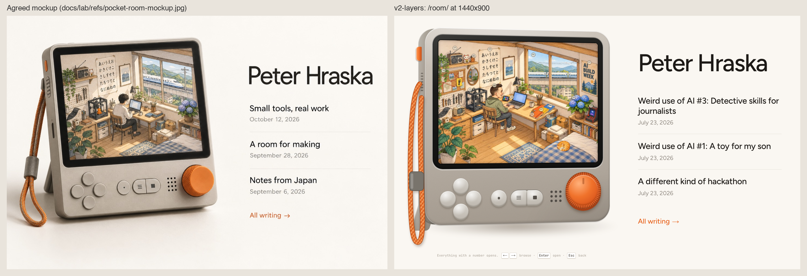

# Pocket Room v2 · attempt `v2-layers` (painted layers)

Branch `lab/v2-layers`, route `/room/`. It replaces v1 entirely: no three.js, no house and no street.
It is the agreed mockup (`docs/lab/refs/pocket-room-mockup.jpg`) built for real: a Teenage
Engineering-style device on the left whose screen is a hand-painted room with mini-Peter at his
desk, and a quiet column on the right with the name, the 3 newest posts and "All writing →".

## Technique: painted layers

The room is ChatGPT image generation (the `codex exec` recipe from the main brief), painted with the
cropped mockup screen and the character refs attached as `-i` references, so every layer shares one
ink-and-watercolour style. The prompts are in `components/room/tools/prompts/`. There are six paintings:

| Painting | What it became |
|---|---|
| `plate` (2 tries, `plate-b` kept) | The empty room: the mockup's composition with no Peter and no chair, window glass painted flat magenta. Every object from the brief is in it: hiragana poster, Fuji print, radio and lucky cat, pegboard, 3D printer, hydrangea, bookshelf, bed with a blue check blanket, plus a mirror, a tabletop arcade, a tiny TV, a stream deck, a clay caveman, a cork board with a yellow footprint and an AI BUILD WEEK poster. |
| `view` | The landscape outside the window: hills, poles and wires, houses, and a horizontal shinkansen viaduct with an empty track. |
| `trains` | Side-view sprites on magenta: a 3-car shinkansen (tail, middle, head; the middle car is repeated to make it longer) and a 2-car local train. |
| `peter-sheet` | Six poses of Peter on the same chair, from the mockup's camera: typing, mug, looking at the window, reading, turning a page, waving. |
| `props` | Three separate notebooks (orange, yellow, blue) at the desk's angle, a sleeping cat, plus a few spares. |

`components/room/tools/build.py` (with `cut.py`) turns the paintings into the shipped layers in
`public/lab/room/` (about 1.1 MB of WebP in total, the plate is 190 KB) and writes the exact positions
to `components/room/scene/layers.ts`:

- **Objects are cut out of the plate itself**, so they register pixel-perfectly. Inside each object's
  box, everything that can be reached from the box edge without crossing an ink line is background;
  what the ink encloses is the object (an edge map from luminance and gradient, closed by one pixel).
  A few masks get a clip polygon or subtract what stands in front (the arcade in front of the
  hydrangea). The hole left under each object is inpainted, so a lifted object leaves a soft shadow,
  not a double.
- Magenta is keyed with despill; the glass becomes a mask, so the view only shows through the panes.
- The printed part is its own layer and grows with a `clip-path`. The window frame is its own layer
  with the view and trains inside it, so the whole window lifts on hover.
- Peter's poses are aligned on the chair, and the hair is darkened (the painting came out mid-brown).
- Each layer also gets a convex hull, used as the hit shape.

The scene (`components/room/scene/RoomScene.tsx`) is plain DOM: a stack of `` layers positioned in
% of the plate, inside a 4:3 screen. No canvas and no WebGL, so it is server-rendered and works without
JavaScript.

## Life on the screen

- Timetable: a shinkansen every 15–25 s, left to right, with a local train the other way in between
  (`nextTrain`, tested). Peter glances at the window when the shinkansen passes, sips from his mug
  every 9–16 s, and otherwise types with a two-frame bob.
- The printer prints (a nozzle glow climbs as the part fills in over 48 s), steam curls from the mug,
  the plant and the hydrangea sway, and the cat breathes on the bed.
- Soft parallax: the view outside shifts a little against the pointer.
- Light follows Tokyo time (morning, day, evening, night with the desk lamp and laptop glowing). The
  small orange button on the side cycles it: Tokyo time, morning, day, evening, night.
- Everything pauses when the device is off screen or the tab is hidden. With reduced motion nothing
  moves (no trains), and everything is still clickable.

## Interaction

- **Idle hint:** small numbered Fig. tags on all 17 objects, with a gentle ping that ripples across
  them every 10 s. They get fuller when the pointer is over the screen. The ≡ key shows them large.
  On touch they are always on and larger.
- **Hover:** the object's own layer lifts (translate plus scale), gets an outline traced from its alpha
  (a chain of CSS `drop-shadow`s: white, then orange, then a soft shadow), the rest of the room dims,
  and a label tag says what it is and where it goes ("Fig. 12 · Arcade → Levels"). Peter turns round
  and waves when you hover him.
- **Hit areas** are real `<a>` links clipped to each layer's hull, so the overlapping notebooks each get
  their own shape. Tab reaches every object, Enter opens it, and without JavaScript every one is still a
  working link: posts, projects, `#about`, `#toy-*`.
- **Device controls work:** the d-pad moves a game-style cursor to the nearest object in that
  direction. The round button opens it. The pill's ≡ shows all tags and ■ goes back. The knob
  browses objects (click for one notch, scroll the wheel over it, or drag it round). Arrow keys,
  Enter and Escape do the same while focus is in the device. Buttons have press travel and click
  sounds (copied from Sidecar's `clicks.ts`).
- **Opening** happens on the screen, like switching apps (it scales up from the object): the window
  opens the shinkansen view (the painted landscape with frequent trains, plus a "Real ride" YouTube
  embed on demand), the mirror opens the face tracker, the poster opens kana flashcards (`lib/study`
  engine, progress saved), the radio plays the Japan sounds (with a link to Mood Radio), the hydrangea
  opens the bloom forecast, Peter opens About, and projects open a card with the painted object and a
  link. Notebooks go straight to their posts, and the bookshelf goes to All writing. "← Room", ■ or
  Escape comes back, and focus returns to the object.
- **Both ways:** hovering a post title lifts its notebook and hovering a notebook underlines the
  title. The same works for the projects and toys lists below the fold.
- **Touch:** the first tap selects (lift, dim, label with an Open button) and the second tap or Open
  opens. Taps between objects pick the nearest object within reach, so every target is effectively
  well over 44 px even though a painted radio is 28 px wide on a phone.

## Pages

- `/room/`: the hero is the device and the column. Below the fold: Projects, "In the room" (the five
  toys, one click each), About, then a footer with RSS.
- `/room/blog/<slug>/`: one readable column. The same device docks sticky in the right margin, zoomed
  a little on Peter and the window. Mini-Peter reads, turns a page at each seventh of the article, and
  waves when the last line is on screen; a thin orange progress line under the screen fills as you
  read. The docked room is decorative (one link back to the room, no extra tab stops). On phones it is
  a slim strip of the screen above the article (Peter reading, the train in the window), never sticky
  and never over the text. Canonical is `/blog/<slug>/`, with `noindex`.
- `/room/writing/`: a plain list by year, with a small notebook spine in each post's colour and a
  device-key "← Pocket Room" link.

## Verified

- `npm test`: 283 passed (21 of them are new tests in `tests/room/room.test.tsx`), and `npm run build`
  passes.
- Scripted Playwright run: hover all 17 objects (lift plus label), list↔room highlighting, open every
  toy and project and come back, Escape returns focus, arrow keys, d-pad, knob, round and ■ keys, the
  side button to night, a notebook navigates to its post, `#toy-kana` opens kana. On a phone: first
  tap shows Open, the second tap opens, Open works, no horizontal scroll, and the first post title
  ends at 571 px of 844. No console errors.
- No JS: the painted room renders and all 17 objects are links. Reduced motion: no trains, and the
  mirror still opens.

## Known gaps

- The screen is 4:3 as the brief says; the mockup's screen is closer to 5:4. Two thin slices of wall
  and plant were cropped off the sides of the 3:2 painting.
- Objects are cut from the plate rather than painted one by one. That gives exact registration, but
  where things overlap a cut sometimes carries a sliver of a neighbour (a bit of shelf under the
  printer, wall seen through the printer frame). A lifted object leaves an inpainted smudge where it
  stood; it is mostly hidden by the lift shadow and the dim.
- Peter has one typing frame (it bobs rather than animating hands), and switching poses is a 180 ms
  cross-fade, not in-betweens.
- The device's 3D turn is turned off on phones and touch, because Chrome rasterises 3D-transformed
  layers at 1× there and the painting went soft. The shell's highlights are CSS gradients, not a
  photographed material.
- Light follows Tokyo time with colour overlays on one day-time painting, not repainted day, dusk and
  night plates.
- The real post dates are all 23 July 2026, so the list shows the same date three times (the
  mockup's titles and dates were placeholders).

## Screenshots (`output/lab/v2-layers/`)

`00-vs-mockup.png` (the acceptance side-by-side), `01-landing-desktop.png`, `02-landing-phone.png`,
`03-hover-arcade.png`, `04-hover-post-notebook.png`, `05-app-window.png`, `06-app-kana.png`,
`07-night.png`, `08-phone-first-tap.png`, `09-post-desktop.png`, `10-post-end-wave.png`,
`11-post-phone.png`.

## Rebuilding the art

The whole recipe (style, references, the `codex exec` command and its quirks, where prompts,
sources and outputs live, and a step-by-step playbook for adding or replacing an object) is the
project skill [`.claude/skills/pocket-room-art/SKILL.md`](../../.claude/skills/pocket-room-art/SKILL.md).
In short, the source paintings are in `components/room/tools/art/` and:

- `python3 components/room/tools/build.py` rebuilds every room layer and `layers.ts`
  (deterministic; repairs in `art/fixes/`, applied by `fixes.py`, go in before keying);
- `python3 components/room/tools/cards.py` rebuilds the app-screen card art (`card-<id>.webp`);
- `components/room/tools/paint.sh <prompt.txt> <out.png> [refs…]` paints one image;
- `node components/room/tools/shots.mjs <baseUrl> <outDir> <prefix>` screenshots the cards and Peter.

Needs numpy, scipy, scikit-image and Pillow. Since `lab/room-art`, the project cards show their
own paintings instead of the blurry plate cut, and the waving Peter has two hands, not three
(screenshots in `output/lab/room-art/`).
